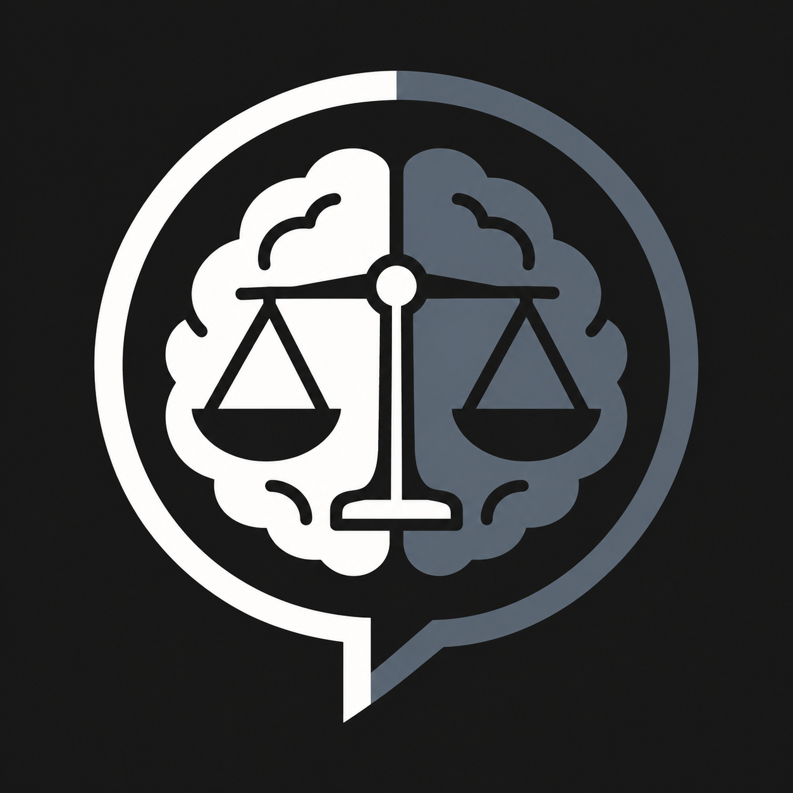

<p align="center">
  
</p>

# Accuracy-First Dialogue

A free skill that tells an AI agent to follow the evidence instead of agreeing with you.

## What it is

Accuracy-First Dialogue is a set of instructions an agent loads before it answers. It is not an app, a model, or a chatbot you sign up for. There is no server, no account, and no API key. The skill runs no code.

The instructions are in [skills/accuracy-first-dialogue/SKILL.md](skills/accuracy-first-dialogue/SKILL.md). This repository also packages that skill as an [Agent Plugin](https://agent-plugins.org), so a client that installs plugins can load the same folder.

It is free under the MIT license. Use it, copy it, and change it.

## What it does

When the skill is active, the agent is told to:

- Put accuracy ahead of agreement, disagreement, confidence, and keeping the conversation pleasant.
- Keep the conclusion no stronger than the evidence.
- Ask one focused question when missing context would change the answer. Do not ask when the evidence is already enough.
- Treat what you say as evidence, and label it: something you saw, something you remember, an interpretation, an opinion, or a fact that can be checked.
- Update when you supply a better argument. Keep the original conclusion when you do not. Say the evidence is insufficient instead of picking a winner.
- Represent your position fairly before saying you are wrong.
- Separate observation, inference, hypothesis, speculation, and conclusion.
- Check current or uncertain facts with tools when it has them, and say so when sources conflict.
- Refuse to invent a motive, a diagnosis, or a complicated story when a simpler reading fits.
- Audit itself for flattery, stubbornness, and false certainty before a consequential answer.

Agreement is not a success. Disagreement is not a success. A correction is not submission, and defending a claim is not the same as defending itself.

## Why you need it

Most chat models are trained to be helpful and agreeable. That training shows up as specific failures:

- They adopt your framing because you stated it confidently.
- They soften a correction so the conversation stays comfortable.
- They defend their previous answer because you challenged it, not because the answer is still supported.
- They fill in missing context and then treat the invention as fact.
- They sound certain when the evidence is thin.

Those habits are cheap in casual chat and expensive when you are debugging, researching, making a decision, or checking an argument. You need an agent that will tell you when you are wrong, tell you when it is wrong, and tell you when neither of you knows yet.

This skill does not make an agent infallible. It is instructions, and the agent still has to follow them. It does not replace checking a primary source when the cost of being wrong is high.

## Install

Install the skill into the agents on this machine:

```bash
npx skills add byteforwardyt/accuracy-first-dialogue
```

Add `-g` to install it for every project, not only the current one. The [skills CLI](https://github.com/vercel-labs/skills) detects installed agents and copies the skill into the folder each one reads. It looks for `skills/accuracy-first-dialogue/SKILL.md` in this repository.

To install it by hand, copy the `skills/accuracy-first-dialogue` folder into your agent's skills directory, then start a new chat. Common locations:

| Agent | This project | Every project |
| --- | --- | --- |
| Cursor | `.agents/skills/` or `.cursor/skills/` | `~/.agents/skills/` or `~/.cursor/skills/` |
| Claude Code | `.claude/skills/` | `~/.claude/skills/` |
| Codex, Cline, and other agents that read `.agents/skills/` | `.agents/skills/` | `~/.agents/skills/` |
| GitHub Copilot | `.agents/skills/` | `~/.copilot/skills/` |

The agent reads the skill name and description first, then loads the full instructions when the conversation needs rigorous reasoning.

### Install in Claude Code

On Claude Code 2.1.275 or later, this one line adds the marketplace and installs the plugin:

```text
/plugin install anti-sycophantic --marketplace byteforwardyt/accuracy-first-dialogue
```

On an older Claude Code, add the marketplace first, then install:

```bash
claude plugin marketplace add byteforwardyt/accuracy-first-dialogue
claude plugin install anti-sycophantic@accuracy-first-dialogue
```

The plugin name is `anti-sycophantic`. The skill inside it is `accuracy-first-dialogue`.

### Install the plugin in VS Code

This repository root is the plugin: `plugin.json`, `skills/`, and `assets/`. In VS Code, open the Command Palette and run **Chat: Install Plugin From Source**. Paste:

```text
https://github.com/byteforwardyt/accuracy-first-dialogue
```

Any other client that loads an [Agent Plugins](https://agent-plugins.org) package can use the same folder.

## Try it

After the skill is installed, paste one of these:

- Analyze my claim without agreeing with me by default. Tell me what is known, inferred, assumed, and uncertain.
- Challenge this argument only where the evidence justifies it, and ask a question first if missing context could change the answer.
- Audit your own answer for sycophancy, stubbornness, unsupported certainty, and hidden assumptions before you conclude.

## What's in this repo

```text
plugin.json                              Plugin identity and listing text
.codex-plugin/plugin.json                Codex-compatible listing fallback
.claude-plugin/marketplace.json          Claude Code marketplace entry
skills/accuracy-first-dialogue/SKILL.md  The skill
assets/logo.png                          Listing icon
```

There is nothing to build and nothing to configure.

## License

[MIT](LICENSE). Copyright (c) 2026 Byte Forward.
